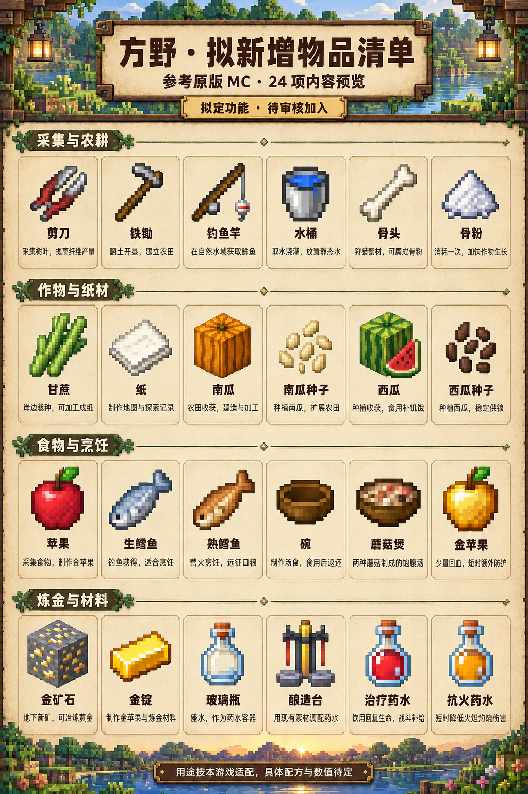

# MC 物品扩充 · 24 项预览稿

状态：以下保留实装前的设计记录；这 24 类物品已写入游戏，容器状态与配套材料另计。实际用途与操作以《物品生物与护甲更新-2026-10-12.md》为准。七材质盔甲与 16 种生物同步加入；剪刀、水桶、骨头与鱼类接入剪毛、挤奶、驯服和生物掉落，金锭也用于金甲等装备。

这批物品形成采集、种植、烹饪和炼金补给的循环。现有铁器、弓、盾牌、铁甲、浆果、面包和蘑菇等作为连接材料。

## 采集与农耕

| 物品 | 预览用途 | 本游戏拟定实现 |
| --- | --- | --- |
| 剪刀 | 采集树叶，提高纤维产量 | 铁锭制作。剪取树叶和野草时效率提高，并可获得额外植物纤维。 |
| 铁锄 | 翻土开垦，建立农田 | 铁锭与木棍制作，直接将草地、泥土翻成耕地，沿用现有播种和收获。 |
| 钓鱼竿 | 在自然水域获取鲜鱼 | 木棍与绳索制作。自然水域中抛竿，按鱼讯收线获得生鳕鱼；避免把主线奖励放入钓鱼掉落。 |
| 水桶 | 取水浇灌，放置静态水 | 铁锭制作，设计为空桶/满桶两种状态。取水、放置静态水源，附近耕地保持湿润；此批不要求流水模拟。 |
| 骨头 | 狩猎素材，可磨成骨粉 | 由现有鹿、野猪的狩猎掉落与遗迹补给提供，可在随身制作中磨成骨粉。 |
| 骨粉 | 消耗一次，加快作物生长 | 骨头加工得到，使用于未成熟作物时推进生长。用于种植循环，避免无成本连用。 |

## 作物与纸材

| 物品 | 预览用途 | 本游戏拟定实现 |
| --- | --- | --- |
| 甘蔗 | 岸边栽种，可加工成纸 | 自然岸边少量生成，在水边沙土栽种并采收，用于造纸；维持稀疏斑块分布。 |
| 纸 | 制作地图与探索记录 | 甘蔗制作，在新版地图配方中使用，亦可用于记录坐标与制作书架。 |
| 南瓜 | 农田收获，建造与加工 | 作为种植产物，可放置装饰或分解种子；此批先补农田与建筑用途。 |
| 南瓜种子 | 种植南瓜，扩展农田 | 南瓜分解获取，可播种于耕地，成熟后收获南瓜。 |
| 西瓜 | 种植收获，食用补饥饿 | 成熟作物提供西瓜；本游戏首版按食物条目处理，也可分解为种子。 |
| 西瓜种子 | 种植西瓜，稳定供粮 | 由西瓜分解获取，在耕地种植，形成可再生食物来源。 |

## 食物与烹饪

| 物品 | 预览用途 | 本游戏拟定实现 |
| --- | --- | --- |
| 苹果 | 采集食物，制作金苹果 | 橡树树叶少量掉落或野外补给获得，恢复少量饥饿，也作为金苹果原料。 |
| 生鳕鱼 | 钓鱼获得，适合烹饪 | 由钓鱼获得，适合送入营火烹饪，提供与狩猎、种植不同的食物来源。 |
| 熟鳕鱼 | 营火烹饪，远征口粮 | 营火将生鳕鱼烤熟，饥饿回复高于生鱼，作为常规远征口粮。 |
| 碗 | 制作汤食，食用后返还 | 木板制作，作为蘑菇煲容器，食用汤后返还，避免一次性耗掉木材。 |
| 蘑菇煲 | 两种蘑菇制成的饱腹汤 | 使用已有褐菇、红斑菇和碗制作，补足蘑菇采集的用途，食后返还碗。 |
| 金苹果 | 少量回血，短时额外防护 | 苹果与金锭制作，用于昂贵的战前补给。拟定少量回复生命并提供短时吸收护盾，连续使用不叠加。 |

## 炼金与材料

| 物品 | 预览用途 | 本游戏拟定实现 |
| --- | --- | --- |
| 金矿石 | 地下新矿，可冶炼黄金 | 作为地下矿物与少量遗迹材料，使用铁级以上镐采集，交给熔炉冶炼。 |
| 金锭 | 制作金苹果与炼金材料 | 金矿石冶炼得到，用于高价值消耗品、酿造台，并按新增需求接入金甲与金马铠。高阶护甲复用已有晶矿与余烬合金，不增加下界合金材料。 |
| 玻璃瓶 | 盛水，作为药水容器 | 由玻璃制作，可装水后用于酿造。空瓶、装水、药水转化按容器状态处理，饮用后返还空瓶。 |
| 酿造台 | 用现有素材调配药水 | 本游戏拟使用铁锭、铜锭和圆石制造，利用现有花草、蘑菇、晶矿及燃料进行酿造，不消耗永久主线藏品。 |
| 治疗药水 | 饮用回复生命，战斗补给 | 使用装水玻璃瓶和现有植物/矿物配方酿造。拟定即时恢复部分生命，与其他药水共用饮用冷却。 |
| 抗火药水 | 短时降低火焰灼烧伤害 | 适合熔炉堡喷口等环境火焰；不抵消冲锋、重击、光弹及坠落伤害。持续效果不重复叠加。 |

## 范围与平衡

- 水桶和玻璃瓶按容器状态设计，原版中的多个状态在这张预览里合并展示，落地时再确定实际物品 ID 数量。
- 沿用已有小麦、胡萝卜、马铃薯及营火、熔炉，增加两个作物和钓鱼食物来源。
- 保持自然植物稀疏斑块分布，新增甘蔗不回到满地连续植被。
- 酿造材料采用当前世界可获得的资源。永久棱镜、晶核和灯塔证明不作为耗材。
- 金苹果及药水为消耗补给，不替代主线机关、Boss 阶段与装备准备。具体时长、冷却、配方和数值待审核后定稿。

## 原版参考

剪刀、钓鱼竿、骨粉与酿造系统的原版用途参考 Minecraft 官方 Taking Inventory 系列；表格中的功能为本游戏的设计适配。

- [剪刀](https://www.minecraft.net/pl-pl/article/taking-inventory--shears)
- [钓鱼竿](https://www.minecraft.net/pl-pl/article/fishing-rod)
- [骨头与骨粉](https://www.minecraft.net/pt-br/article/taking-inventory--bone)
- [金苹果](https://www.minecraft.net/de-de/article/golden-apple)
- [酿造台](https://www.minecraft.net/fr-fr/article/taking-inventory--brewing-stand)

## 图像生成

使用 imagegen 技能及内置图片生成工具。完整提示词保存于 `previews/mc-item-expansion-24-v1.prompt.txt`，选定的预览图保存于同目录。

