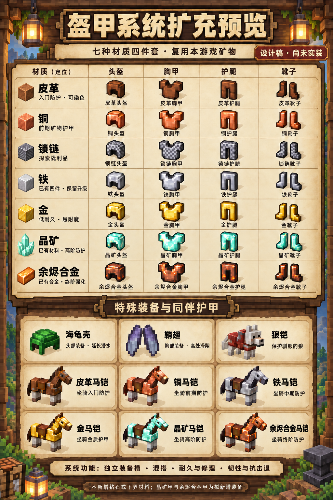

# 盔甲与常见生物扩充预览稿

状态：以下保留实装前的设计记录。已按 v2 材质方向加入游戏，具体效果、配方、操作与范围以《物品生物与护甲更新-2026-10-12.md》为准；保护/耐久两种附魔已加入，完整原版附魔及纹饰未纳入这一批。v1 图留作历史设计稿。

## 玩家盔甲

七种材质：皮革、铜、锁链、铁、金、晶矿、余烬合金。每种含头盔、胸甲、护腿、靴子，共 28 件；已有铁甲四件保留，新增其余 24 件。晶矿与余烬合金材料已经存在，新增的是它们的护甲，不重复新增矿物。

| 材质 | 拟定定位 | 获取与功能 |
| --- | --- | --- |
| 皮革 | 入门防护 | 皮革合成；可染色；成本低，防御低。 |
| 铜 | 前期矿物护甲 | 铜锭合成；铜装不氧化；在皮革与铁级之间提供稳定过渡。 |
| 锁链 | 探索战利品 | 遗迹箱与精英掉落；避免只是另一套铁锭配方。 |
| 铁 | 中期基准 | 保留已有铁甲，统一接入装备显示、耐久与修理。 |
| 金 | 低耐久、易附魔 | 金锭制作；低耐久与较弱防护；附魔系统随这次装备扩充补充。 |
| 晶矿 | 高阶防护与韧性 | 使用已有晶矿，沿用铁镐采集和地下矿物来源；拟补四件护甲，避免另外开设钻石矿物与工具线。 |
| 余烬合金 | 终阶强化 | 使用已有余烬合金，在现有校准台升级晶矿甲；拟提升耐久与抗击退，控制总减伤，不另增远古残骸、合金碎片、下界维度或新的锻造站。 |

校准台已有配方：铁锭 ×2、晶矿 ×1、煤炭 ×1 → 余烬合金 ×1。盔甲升级的具体耗材待定，并且不消耗永久主线棱镜或晶核。继续维持铁甲与现有晶矿武器可以通关的主线原则，不把全套终阶护甲设为强制门槛。金甲、锁链与铜甲是选择分支，不要求按七套顺序逐套制作。

系统包含：四个独立装备槽、混搭、护甲值、护甲韧性、击退抗性、逐件耐久、材料修理、库存说明与角色外观。混搭不会凭空增加原版没有的套装奖励。拟补充附魔台/附魔书（保护、耐久、修补、摔落保护、水下呼吸等基础装备词条）及纯外观纹饰；具体词条、配方、材料和模板清单在落地前定稿，当前图展示装备本体。

## 特殊装备与同伴护甲

| 装备 | 拟定用途 |
| --- | --- |
| 海龟壳 | 占头部装备槽，海龟幼体成长提供鳞甲，制作后延长潜水时间。 |
| 鞘翅 | 占胸部装备槽，支持从高处滑翔并消耗耐久；通过主线通关后的探索奖励获得。 |
| 狼铠 | 仅给已驯服狼装备，消耗犰狳鳞甲制作与修理，保护协战同伴。 |
| 皮革、铜、铁、金、晶矿、余烬合金马铠 | 六种坐骑护甲，保护驯服后的马；单独的坐骑装备槽；余烬合金马铠在校准台由晶矿马铠升级。 |

展示范围为 28 件玩家常规盔甲、2 件特殊玩家装备、7 件狼/马护甲，共 37 个装备款式；其中已有铁甲 4 件。本稿不把海龟壳扩成四件套，也不把鞘翅视为高防御胸甲；未选择的鹦鹉螺及其装备不属于这批候选。

## 新增生物：16 种

| 生物 | 栖息地 | 拟定作用 |
| --- | --- | --- |
| 牛 | 温带草地 | 皮革、肉与挤奶 |
| 猪 | 草原与林缘 | 繁殖养殖，提供肉食 |
| 羊 | 草地与缓坡 | 剪取羊毛，可染色 |
| 鸡 | 林缘与草地 | 产蛋、羽毛与鸡肉 |
| 狼 | 森林与针叶林 | 骨头驯服，跟随协战 |
| 猫 | 营地周边 | 鱼类驯服，陪伴基地 |
| 马 | 开阔草原 | 驯服骑乘，远征代步 |
| 狐狸 | 林地 | 灵敏避人，丰富野生生态 |
| 犰狳 | 干燥草原 | 收集鳞甲，制作狼铠 |
| 鳕鱼 | 河流与湖泊 | 水中成群，钓鱼食材 |
| 鱿鱼 | 较深水域 | 水下游动，提供墨囊 |
| 海龟 | 沙滩与岸边 | 繁殖成长，获取海龟鳞甲 |
| 僵尸 | 夜晚与暗处 | 近战追击，基础夜间威胁 |
| 骷髅 | 夜晚与洞穴 | 远程射箭，掉落骨头 |
| 苦力怕 | 夜晚荒野 | 接近蓄爆，可提前打断 |
| 蜘蛛 | 暗处与洞穴 | 攀爬追击，掉落蛛丝 |

动物支持相应食物引诱和繁殖；幼体成长与产蛋/剪毛/鳞甲脱落设间隔。狼、猫可驯服并保存归属和跟随/停留状态；马可驯服、装备鞍与马铠、骑乘。苦力怕攻击有可见蓄力与打断窗口，天然爆炸避开主线机关，并限定地形破坏半径；实际破坏规则需随实现确定。

各物种按地貌、温湿度、水深、昼夜与亮度选择刷新点。小群与独立个体混合，设物种上限、区域总量上限和最小间距；基地附近普通敌对生物沿用现有营火安全区。驯服动物、繁殖动物与持久交互个体写入存档并避免重复生成。保留现有鹿、野猪与原创敌人；生物多样化不通过无上限提高数量实现。

## 对 24 项清单的补充

剪刀增加剪羊毛；水桶增加牛奶容器用途；骨头可从骷髅掉落并用于驯服狼；鱼类支持猫的驯服与钓鱼。金锭兼作金甲与金马铠材料；余烬合金继续使用已有铁锭、晶矿、煤炭配方。

新增盔甲与生物还需要配套材料：羊毛/染料、蛋、羽毛、牛奶容器、蛛丝、火药、墨囊、犰狳鳞甲、海龟鳞甲、鞍等。它们不冒充为原 24 项已包含的内容；原 24 项是功能选型数量，容器状态可能对应多个运行时 ID。晶矿、余烬合金与校准台直接复用已有定义，不新增钻石矿、远古残骸、合金碎片、下界合金或独立锻造台。

## 原版官方参考与本游戏适配

- [The Copper Age 正式更新](https://feedback.minecraft.net/hc/en-us/articles/39966147272589-Minecraft-Java-Edition-1-21-9-The-Copper-Age)：铜盔甲四件套、铜马铠，铜装备不氧化。
- [Armored Paws 正式更新](https://feedback.minecraft.net/hc/en-us/articles/26107776674445-Minecraft-1-20-80-Armored-Paws-Bedrock)：犰狳鳞甲与狼铠。
- [海龟壳](https://www.minecraft.net/nb-no/article/taking-inventory-turtle-shell)。
- [鞘翅](https://www.minecraft.net/en-us/article/taking-inventory--elytra)。

装备槽、四件套结构与部分装备品类参考原版；高阶材质改用本游戏的晶矿和余烬合金，不宣称它们是 MC 原版材质。获取地貌、资源链、攻击打断和数值采用本游戏设计。上述表格不是实现完成报告。

## 图像生成

沿用 imagegen 技能，使用内置图片生成工具；提示词存放于 previews 下的同名 .prompt.txt。当前预览文件：mc-armor-expansion-v2.png、mc-mob-expansion-16-v1.png。v2 在 v1 图上编辑，并保留 v1 原件。

