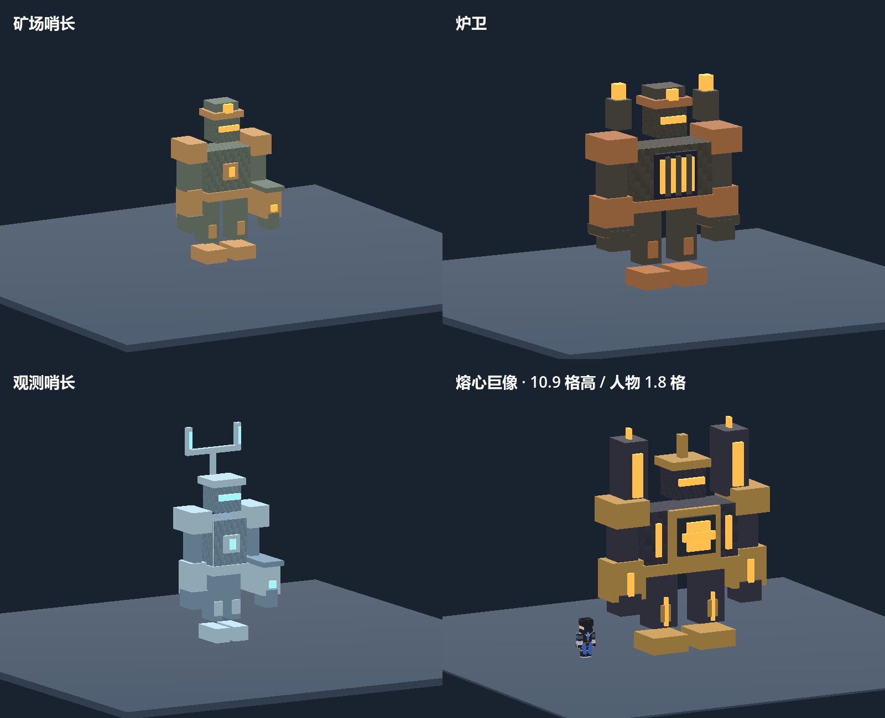

# 三塔归火试玩更新

2026-10-12。本次实现新增世界主线与巨像放大版，原有世界保留原地形和路线。请运行 `EmberLighthouse-mainline/EmberLighthouse.exe`，或完整解压 `EmberLighthouse-mainline试玩包.zip`。

## 主线与操作

新建标准生存世界，按 **J** 查看日志。路线：营地与铁器 → 废矿场哨长 → 寻路塔 → 旱地熔炉堡、雪岭观测所（顺序自选，均需完成）→ 校准塔 → 深层晶穴守护者 → 镇封塔 → 地心遗址 → 熔心巨像。

- 五处遗址由种子生成固定可达结构，含入口坡道、采矿障碍、喷焰通道、雪岭高台与地下供能室；在已探索大地图上显示入口。
- J 日志给出方向和距离，勘测镜右键定位目标。默认不显示远处精确坐标，日志可开启精确位置提示。
- 三座灯塔分别检查区域战斗成果并解锁线索、校准配方与终局。校准塔修复后，已点亮灯塔之间可消耗煤旅行，附近有敌人时不可旅行。
- 修塔总耗材：铜线圈×5、铁锭×12、灯塔符印×1。炉心棱镜、霜辉棱镜、共鸣晶核记入永久藏品，不占背包，不因死亡丢失。
- 地心遗址有三处实体节点：补齐六格电桥后连接供能；读取碑文并旋转反射器到正确方向；击败供能室守卫。完成三塔和三节点后，Q 使用核心控制台开战。
- 巨像先由四个锚点提供护盾。Q 关闭近处锚点；高处可射箭，或走阶梯、搭建接近。锚点不消耗额外材料。
- 断流后巨像轮换光弹、冲锋和范围重击；重击结束后的窗口承受完整伤害，其余时间减伤。生命低于 35% 缩短前摇与间隔。
- 主线精英不受营火安全区限制。巨像败退、死亡或主动重置只清除本场战斗，机关和灯塔保留；标准死亡背包转移到地表入口。击败巨像后进入自由探索，解锁纪念灯。

## 新增物品和设施

目录现有 117 个条目、79 个配方、10 类生物。18 个新增条目中，12 个为玩家材料、装备或设施，6 个为矿石及遗址专用机关。

| 玩家物品 / 设施 | 用途 |
|---|---|
| 铜线圈 | 灯塔、勘测镜、校准台材料 |
| 勘测镜 | 右键追踪当前阶段目标 |
| 耐热衬片 | 在装备维护中安装到铁胸甲，喷口伤害降低 75% |
| 炉心棱镜、霜辉棱镜 | 两处区域精英提供的永久主线藏品 |
| 校准台 | Q 打开新配方与装备维护 |
| 余烬合金 | 铁、晶矿和煤制作的进阶材料 |
| 余烬剑、余烬弓 | 进阶武器，有耐久 |
| 共鸣晶核 | 深层守护者提供的永久藏品 |
| 修理包 | 在工作台 / 校准台补充 40% 最大耐久，上限为满耐久 |
| 黎明之心纪念灯 | 巨像奖励，完成后也可制作，提供照明 |

遗址条目：铜矿、古代碑文、供能节点、反射器、核心控制台、供能锚点。机关在生成位置使用 Q 交互，不能通过普通采掘拆除。棱镜与晶核的任务取得状态以 J 藏品记录为准。

## 怪物实际模型

新增矿场哨长、炉卫、观测哨长和熔心巨像使用四种独立方块模型。巨像模型约 10.9 格高，人物约 1.8 格；身体碰撞高 10.9、宽 4.5 格，地下场地净高 18 格。早期生成的概念图是造型参考；下图来自游戏渲染器。

## 存档和验收范围

存档格式升级为 5，旧格式首次保存前自动保留原格式备份。旧世界的生成器 1 / 2 和三塔位置保持原样，新建世界使用生成器 3。机关、藏品、耐热衬片、护盾与战斗时间、巨像生命及攻击状态都可保存。

已通过 63 项核心测试和控制材料的原生运行时主线检查：真实 UI 修塔、区域精英死亡回调、配方制作与维护、实体桥检测、方向解谜、供能室守卫、真实箭关闭高锚点、巨像碰撞和护盾、核心暴露窗口、预警跨阶段的一致性、低血量前摇加速、保存并重建世界、终局死亡重试、完成状态保存。检查中提供材料并在遗址之间传送，因此它验证流程可达性与状态正确性，不测量正常生存首通时长。

“约原版 MC 末影龙流程 80% 难度”和首通 10–14 小时仍是设计目标，尚无完整玩家试玩证据。当前遗址为可玩的首版结构，房间规模、探索时长、敌人血量及资源节奏仍需根据实际试玩调整。原设计审核稿保留为设计依据，不应把其中的所有预算和体验描述当成已验收结果。

