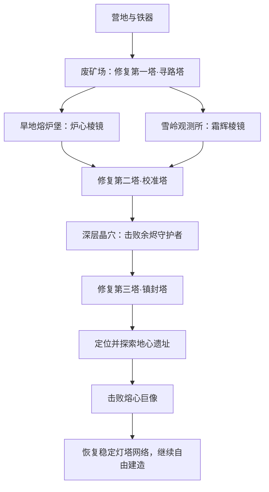

# 《方野：余烬灯塔》主线重设计：三塔归火

状态：保留的设计审核稿。2026-10-12 已实现可玩的首版，实际范围见「三塔归火更新.md」；本稿中的时长、难度及场景预算仍待试玩校准。原稿日期：2026-10-11。

## 1. 体验目标与参照

主线目标：从荒野建立营地，恢复三座功能不同的灯塔，深入古代能源遗址，击败失控的「熔心巨像」，让灯塔网络恢复稳定。

以原版 Minecraft Java 普通难度、单人生存、熟悉基础操作、首次正常推进击败末影龙的体验为参照。允许查游戏内提示，不按速通、种子攻略、床爆破或成熟交易流水线估算。

“80% 难度”是待试玩校准的体验目标，不是可以直接换算的数值。保留远征准备、跨区域材料、定位终局地点和多阶段战斗；降低关键资源的随机性、失误损失和重复赶路负担。不把敌人血量直接设为 MC 的 80%。

目标首次主线耗时 10–14 小时，含必要装备、基本营地、首次探索和少量失败重试，不含大型建筑或全收集；熟悉路线后的目标为 6–8 小时。两者都是预算，当前没有试玩证据。

MC 参照依据：官方说明中的末影之眼材料、要塞定位与传送门构成一条准备链；末影龙战要求处理水晶并切换远近战机会。本稿借鉴的是这种成长与能力检查的结构。

- https://www.minecraft.net/en-us/article/stronghold
- https://www.minecraft.net/en-us/article/ender-dragon

## 2. 当前流程为何容易很快完成

核对当前源码：三座灯塔坐标固定为 (64,48)、(-120,90)、(160,-144)，离原点约 80、150、215 格。三座塔使用相同的「符印 ×1、铁锭 ×2」修复条件；铁镐可以取得主线所需晶矿；击败一个守护者并激活三塔即完成主线。

需要增加不同区域的准备要求、探索发现和阶段奖励。扩大地图距离只能解决一小部分问题，不能作为主要时长来源。

## 3. 主线结构

旱地和雪岭是两条都需要完成、顺序自选的路线。其他地方允许提前探索，拿到的发现和区域证明会记录；不要求按任务编号完成采矿、建房或制作装备。

| 阶段 | 玩家实际要做的事 | 新挑战与收益 | 分段预算 |
| --- | --- | --- | --- |
| 1. 荒野落脚 | 获得石器、食物、工作台和初步铁器；在废营地读到灯塔线索 | 学习照明、复活点与补给。农田、床、小屋有实际收益，但不做强制打卡 | 0.5–1 小时 |
| 2. 第一束光 | 探索废矿场，打通坍塌通道，击败矿场哨长，修复寻路塔 | 第一次组合使用挖掘、掩体、盾牌；解锁勘测镜和两条区域线索 | 1–1.5 小时 |
| 3. 双域远征 | 自选顺序完成旱地熔炉堡与雪岭观测所，分别获得两枚棱镜 | 一条考验热区路线与近战，一条考验垂直移动与远程威胁 | 2.5–3.5 小时，含两条路线 |
| 4. 校准与下潜 | 将两枚棱镜安装到第二塔；建校准台；探索深层晶穴 | 解锁余烬合金装备和深层信号；晶穴提供可采集补给与多层路径 | 1.5–2 小时 |
| 5. 镇封者 | 深入晶穴大厅，击败现有余烬守护者，取得共鸣晶核并修复第三塔 | 检查躲避范围攻击、处理掩体和补给的能力；定位终局遗址 | 1.5–2 小时 |
| 6. 地心遗址 | 进入多层遗址，恢复三个不同的供能节点，打开核心室和返程捷径 | 一段搭建跨越、一段观察机关、一段组合战斗；完成节点永久保留 | 1–1.5 小时 |
| 7. 归火 | 建立门外前哨，挑战熔心巨像，稳定黎明之心 | 综合使用弓、近战、移动、方块和食物，完成主线 | 0.5–1 小时，含准备 |

分段相加为 8.5–12.5 小时，另为学习、绕路和少量重试预留约 1–1.5 小时，取整后作为约 10–14 小时目标。不得用等待倒计时或延长冶炼来填满预算。

## 4. 三座灯塔分别改变什么

| 灯塔 | 激活条件（初始设计值） | 玩家获得的能力 |
| --- | --- | --- |
| 第一塔·寻路塔 | 击败矿场哨长取得永久记录；铜线圈 ×1、铁锭 ×4 | 显示旱地、雪岭目标的大致方向和线索；解锁勘测镜；标记第一处稳定据点 |
| 第二塔·校准塔 | 安装炉心棱镜与霜辉棱镜；铜线圈 ×2、铁锭 ×4 | 开启第一、第二塔旅行；解锁校准台、余烬合金、灯塔符印新配方；发现深层晶穴入口 |
| 第三塔·镇封塔 | 安装守护者的共鸣晶核；灯塔符印 ×1、铜线圈 ×2、铁锭 ×4 | 开启完整三塔旅行；勘测镜可追踪地心遗址；终局核心室允许启动 |

旅行沿用每次煤炭 ×1和脱离战斗条件。已经支付的修复材料、安装的棱镜、晶核和任务证明不因死亡或重进消失。

第一塔附近需要有普通铜矿的稳定来源，铜不能只来自随机宝箱；这是本方案需要补充的资源生成内容。

勘测镜不会随机损坏，也不消耗稀有材料。远处显示方位与大致距离区间，靠近后显示地标；在目标附近停滞约 10 分钟可主动开启更明确提示，不弹窗催促正在建造的玩家。

## 5. 两次远征的具体体验

### 旱地熔炉堡

可观察到红色矿渣、残破运输通道和喷焰管线。火焰使用固定、可预读的喷口，不依赖动态岩浆。

- 准备：铁器、盾牌、食物、方块；可制作耐热衬片安装在铁胸甲上，减少喷口伤害。没有衬片也能沿较长的外侧维修通道通过。
- 路线：外侧通道安全但需要搭桥；内侧通道更短，需要观察喷焰节奏。玩家可挖墙或搭掩体缩短部分路程。
- 关底：炉卫，基于哨兵制作的精英变体，交替使用正面喷焰与短距离冲撞；从侧后方攻击有明显收益。
- 奖励：炉心棱镜必得；普通铜铁和装饰材料作为额外奖励。无须反复刷同一个敌人。

### 雪岭观测所

玩家沿断桥、山腹通路或自行搭建的阶梯接近观测所。

- 准备：弓箭、照明、建筑方块与熟食；没有保暖条、口渴条或天气伤害倒计时。
- 路线：山腹通路较长、有近战敌人；山脊路线较短、会遭遇远程敌人。低层有落脚台，坠落仍危险，但不会直接进入虚空。
- 关底：观测哨长，基于哨兵的精英变体，使用有明显提示的连续射击；持续站在同一个掩体后会被范围落点逼迫移动。
- 奖励：霜辉棱镜必得；额外补给和建筑装饰。观测设施可提前发现，棱镜获取不依赖先去旱地。

两枚棱镜记录为已获得的主线藏品，不占用普通背包，也不能丢弃或销毁。安装到第二塔后显示在塔体上。

## 6. 装备与物品成长

基础成长仍为木/石器 → 铁器 → 晶矿工具。铁镐仍能开采普通晶矿；新增的余烬合金用于少量终局战斗装备，不另铺一整套重复工具和护甲。

铁甲、晶矿剑、普通弓应当具备通关能力；余烬武器和耐热衬片提供更宽裕的应对空间，不作为硬性装备检查。

建议新增 12 个物品或设施条目：

| 新条目 | 来源与用途 |
| --- | --- |
| 铜线圈 | 工作台：铜锭 ×2、铁锭 ×1 → 1；用于灯塔、勘测镜和校准台 |
| 勘测镜 | 工作台：铜线圈 ×1、玻璃 ×2 → 1；重复使用的线索定位工具 |
| 耐热衬片 | 工作台：皮革 ×2、布料 ×2、铁锭 ×1 → 1；给铁胸甲安装一个耐热效果，可拆回，不与副手冲突 |
| 炉心棱镜 | 炉卫首次胜利必得；第二塔主线藏品 |
| 霜辉棱镜 | 观测哨长首次胜利必得；第二塔主线藏品 |
| 校准台 | 第二塔解锁；工作台：铜线圈 ×2、木板 ×4、铁锭 ×4 → 1；制作余烬装备 |
| 余烬合金 | 校准台：铁锭 ×2、普通晶矿 ×1、煤炭 ×1 → 1；使用第二塔记录的校准参数，不消耗棱镜 |
| 余烬剑 | 校准台：余烬合金 ×3、木棍 ×2 → 1；比晶矿剑略高伤害，优先改善耐久与攻击可用性 |
| 余烬弓 | 校准台：余烬合金 ×2、木棍 ×3、绳索 ×2 → 1；沿用普通箭，提高射击效率 |
| 共鸣晶核 | 余烬守护者首次胜利必得；第三塔主线藏品，替代现有符印掉落 |
| 修理包 | 工作台：铁锭 ×2、布料 ×1 → 1；在工作台消耗，恢复一件工具或装备约 40% 最大耐久，受最大值限制 |
| 黎明之心 | 熔心巨像首次胜利后记录；完成主线并解锁基地纪念灯塔外观，不可丢失 |

现有灯塔符印改为第二塔解锁后制作：铁锭 ×2、普通晶矿 ×2 → 1，供第三塔使用。旧配方不再承担三塔全部进度。

粮食沿用现有食物体系，让熟食方便远征。农田帮助稳定补给，狩猎和采集仍可替代；不强制玩家收获指定次数。

资源核算示例：三塔本体的直接修复共需 5 个铜线圈、12 个铁锭、1 枚符印，展开为 10 个铜锭、19 个铁锭、2 个普通晶矿，另需两枚区域棱镜、共鸣晶核及矿场证明。此数不含工具、勘测镜、校准台、装备和冶炼燃料；不是全流程最低物资表。

包含三塔修复，再按铁甲、铁镐、盾牌、勘测镜、校准台和一把余烬剑计算，一套正常推进准备需要 60 个铁锭，另加耐热衬片、修理包、其他工具和补给的选择性消耗。这是采集预算检查点；若试玩重复采矿占比过高，应降低配方成本或改善矿脉，不继续加大材料需求。

## 7. 终局战：熔心巨像

巨大、缓慢、轮廓清楚的古代机械守卫，使用现有遗迹美术风格。场地为可搭建的环形能源大厅，下层有维修走道，跌落会受伤并失去位置优势，但不直接永久丢失装备。

目标正常单次战斗约 5–8 分钟，提前给玩家观察场地的机会；点击核心台后才开始。外部有床和箱子可用的前哨空间。

| 阶段 | 玩家目标 | Boss 行为与应对 |
| --- | --- | --- |
| 断流 | 关闭四个供能锚点 | 两个在地面，两个位于高台；均可近距离拆卸，高台弱点也可用箭处理。Boss 缓慢追踪并发射有落点提示的光束。搭阶梯、掩体、绕路都有效 |
| 破甲 | 四锚关闭后，将本体生命降到 35% | 侧移躲冲撞，跳跃或避开扩散震波，攻击暴露核心。弓可打远处核心，近战有更高的有效输出机会 |
| 熄火 | 击败余下本体 | 复用已经见过的招式，略缩短间隔；每次重击后保留明确恢复空档。场地危险区域轮换，不用全场必杀或突然加入未经教学的新规则 |

难度初值：满生命、完整铁甲状态下，普通失误约扣 10%–15% 最大生命，重击约扣 25%–30%；重击前摇至少约 1 秒。各攻击不能形成无法脱身的连续硬直。这些是护甲结算后的目标值，落地时必须结合实际战斗系统测量。

盾牌能处理正面射击，不能完全抵消地面震波；方块掩体对射击有效，重击可破坏命中附近的少量普通方块，预警须清楚。战斗规则不得因为玩家使用搭建而临时取消其收益。

无飞行追逐、无必须精确瞄准的小像素弱点、无强制连续跑酷。若流程整体已达到目标难度，应降低终战操作压力，而不是继续堆阶段。

死亡或主动撤退后，本场 Boss 血量与锚点重置；地心遗址的三个供能节点、入场资格、已开捷径及世界建筑保留。掉落背包转移到门外回收台，便于重新准备。退出游戏则保存当前战斗状态，不能用重启刷新已消耗补给。

## 8. 世界、指引与防卡进度规则

- 第一塔距出生点约 250–400 格；区域目标约 600–1000 格；第三塔和终局遗址约 1000–1500 格。具体按种子生成与可走路径调整，所有必需地点处于世界边界内。
- 距离只是布局范围。初次旅途要有资源、地标、可绕行的敌人和可休息地点；已探索路线通过灯塔与捷径压缩，重试一般应在 1–3 分钟内回到挑战门口。
- 三塔和关键遗址需在生成时验证存在、可达、有必要材料；随机性只改变位置、局部布局与额外奖励。找不到时使用确定性的备用位置，不靠玩家重开种子。
- 主线藏品和 Boss 胜利证明使用永久记录。背包满、死亡、重复互动或保存重进都不能卡住主线；获得与安装须只结算一次。
- 建房、装备推荐和食物准备属于指导，不锁任务。区域棱镜、三塔状态和终局启动资格属于必须满足的条件；界面明确展示缺少哪一项及已知来源。
- 普通地形可挖掘，玩家可以挖入遗址或建桥绕过路段。关键设备受到保护并清晰显示原因；供能与终局启动条件由设备状态决定，不用整片空气墙维持顺序。
- 地心遗址三个节点分别是实体电桥修复、能从环境读出答案的反射器校准、击败供能室守卫，不设计反复交同一种材料的三个任务。
- 营火保留荒野安全作用，但指定遗迹守卫和 Boss 不受其驱散。进入遗址前明确提示；否则现有营火打断攻击规则会使精英战失去意义。
- 区域精英首次战胜后，藏品和完成记录不会重复发放；可选再挑战仅给普通资源，不成为推进必要步骤。

## 9. 难度校准与验收

先把“80%”转成可观察目标，再通过配对试玩调整。对照组与本游戏都采用普通难度、单人、基础操作熟悉的玩家，记录版本、装备、提示使用与游戏经验，不引用所谓 MC 通关统一时长。

| 维度 | 本稿目标 | 观察方式 |
| --- | --- | --- |
| 资源准备 | 多次出门有不同目的；主线普通资源可预测取得 | 记录重复采矿、缺料返程与配方造成的等待，纯重复采集尽量低于主线时间的 20% |
| 探索负担 | 需要认路、观察和准备，但不会无限找随机关键掉落 | 记录无新发现的赶路，重复赶路尽量低于 15%；提示后不再出现长期无方向状态 |
| 战斗压力 | 完整铁甲和普通弓可通关；进阶装备降低失误成本 | 区域精英通常 1–3 次尝试；终战多数目标玩家 1–3 次、较困难者 4 次左右，超出时回看失败原因 |
| 死亡代价 | 损失部分时间和消耗品，保留已完成进度 | 核对重新准备和返回现场时长，不能重刷棱镜或重新付开门费 |
| 成长节奏 | 每约 30–60 分钟出现有意义的新发现或能力收益 | 从试玩日志查看连续只采同种材料、只走路或只刷同种敌人的段落 |
| 综合体验 | 同一玩家对本游戏的整体挑战感约为参照流程的四分之三到五分之四 | 用多维评价和失败记录复核，不能仅凭完成时间或一个评分宣称精确达到 80% |

首轮 5–8 名目标玩家用于发现卡点，不作为严格统计证明。若战斗已合适而时长不足，优先完善遗址路线、区域选择和阶段奖励；若纯赶路或采矿过多，直接缩短这些环节。

## 10. 内容边界与实施影响

本方案是主线扩展，工作量明显大于调配方和血量：

- 复用：生存、农业、装备、弓盾、三塔旅行、地图、矿物、六种生物基础、原有余烬守护者。
- 新增：12 个物品/设施条目，矿场哨长、炉卫、观测哨长 3 个精英变体，1 个终局 Boss；废矿场、熔炉堡、雪岭观测所、深层晶穴大厅和地心遗址的可玩布局。
- 调整：三塔位置和独立功能、主线指引、铜矿来源、关键藏品记录、合金制作、装备衬片与修理、遗迹安全区例外、终局战持久化。
- 地心遗址位于当前世界的地下区域；不依赖新维度、动态流体、村民交易、完整附魔或药水系统。其高度与布局须遵守现有 192 格世界高度。
- 原开发计划的生物、物品和内容上限需要在本稿通过后同步调整；本稿不声称仍能放入原有内容预算。
- 旧世界保留原生成器和原主线。新版主线优先用于新建世界；如后续要求旧世界也能体验，需要单独设计遗址补生成与进度转换，不能直接覆盖玩家建筑。

建议实施顺序：先做第一塔和一条区域路线的可玩样板，验证准备与探索是否有趣；再完成双路线、三塔和中期守护者；最后完成终局遗址、Boss、存档与完整流程平衡。

## 11. 本次审核的四个决定

1. 首次主线目标采用 10–14 小时，熟悉后允许明显缩短，是否符合期望？
2. 是否接受两条顺序自选、都需要完成的区域远征？
3. 是否接受现有守护者转为中后期关卡，并新增熔心巨像作为终局？
4. 是否接受新版主线先用于新建世界，保留旧世界原有进度？

审核通过后再拆分实施任务。所有名称、配方和战斗数值均为此稿提案。

