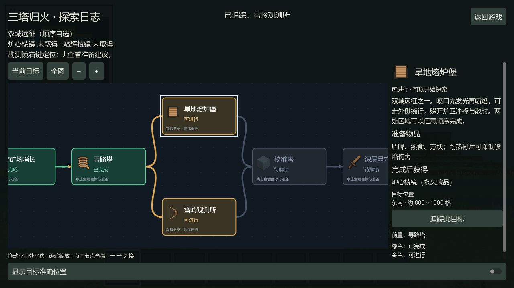
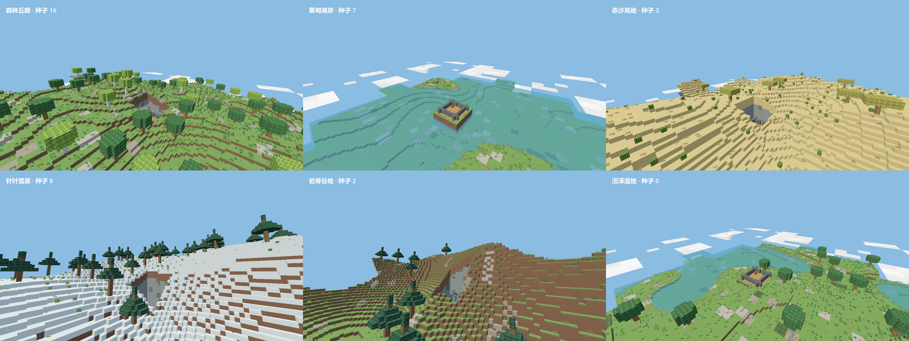

# 探索体验更新

新版试玩入口：`builds/EmberLighthouse-exploration/EmberLighthouse.exe`。可分发包：`builds/EmberLighthouse-exploration试玩包.zip`，完整解压后运行。

## 世界删除与恢复

主菜单 → 读取与备份世界 → 对应世界下方的「删除」。显示名称和编号，确认后从世界列表移除。取消不改变文件。旧格式、同名世界和损坏世界也可以删除，按世界编号隔离处理。

删除的目录移动到存档根目录旁的 `deleted-worlds`，保留存档、区块和生成版本；「已删除世界 → 恢复世界」可以找回。同编号的活动世界已经存在时拒绝覆盖。已有备份保留。此次开发检查仅使用工作区内的测试存档，没有处理玩家实际存档。

## 箱子补给

未打开的野外箱子，按种子、位置、气候和遗址种类确定补给。矿工补给偏矿石与照明；熔炉维修偏燃料、金属和维护；雪岭偏布料、绳索、弓箭；晶穴偏照明和晶矿；地心遗址偏终局消耗品。

每箱抽取 4–6 种不同物品，数量也会变化。同一种子同一位置结果可复现；首次打开后存入存档，取空、退出、重进不会刷新。玩家放置的箱子为空，已经打开的旧箱子保留已有内容。起始废营地额外保证地图和三种作物。随机箱子不会提供主线棱镜、晶核或跳过机关的钥匙。

## 交互日志

按 J 打开任务导图。金色为可进行、绿色为已完成、灰色为待解锁。双域远征分叉后在校准塔汇合；遗址三个供能节点完成后汇合至巨像挑战。

- 拖动空白区域，或用鼠标中键拖动，平移导图。
- 滚轮和 ＋ / − 按钮缩放；「全图」查看整条路线，「当前目标」回到当前阶段。
- 点击节点查看玩法说明、准备物品、奖励、位置和前置条件。
- 可进行或已完成节点可以追踪，在游戏 HUD 显示方向和距离。
- ← / → 切换节点。重开日志保留本次世界的浏览位置。

生成器 1、2 的旧世界也使用导图，显示原版三塔与守护者的并行路线，不增加新版主线条件。

右侧详情自动换行，只保留竖向滚动，避免原日志的横向溢出。

## 地貌与植物

新世界使用生成器 4，按种子选择六种起始区域：森林丘陵、草甸湖岸、赤沙高地、针叶雪原、岩脊谷地、沼泽湿地。创建界面显示当前种子的开局区域。开局只保留约九格半径的平整落脚点，附近地形逐渐衔接到自然高度；湖岸、沙丘、山脊和湿地区域有不同的高度与植被分布。地下洞穴也随种子变化。

新增白桦、松树、金合欢三种原木与树叶，共四种基础树木造型；新增高草、枯草、蕨草、芦苇、朱红花、蓝铃花、褐菇、红斑菇。植物使用独立像素贴图，不产生阻挡碰撞。新原木采集后得到通用原木，继续使用原来的制作路线。目录共 131 个条目、79 个配方。

生成器 1、2、3 的旧存档保留原地貌和主线版本，新地貌需要新建世界。同一种子可复现地形；随机新种子有时仍会落入同类区域，并不保证每次都选择不同气候。

## 验证范围

本包通过 69 项核心检查及 8 组发布版检查（启动、探索更新、主线、战斗、生物、装备、界面图标和存档界面）。发布检查记录冻结了 EXE、PCK 与程序集的 SHA256。

核心检查覆盖旧世界删除/恢复及字节保持、危险路径拒绝、损坏存档、箱子种类和持久化、任务分支前置、六类开局及八种植物、原木采集和旧生成器兼容。原生游戏检查覆盖确认取消、删除与恢复按钮、节点点击、平移、光标中心缩放、目标追踪和三种字体比例。实机预览来自 Godot 渲染器。

这些检查使用控制场景，不等于完整的人工生存试玩或长期性能验收。主线时长和相对 MC 的难度仍需试玩反馈。
