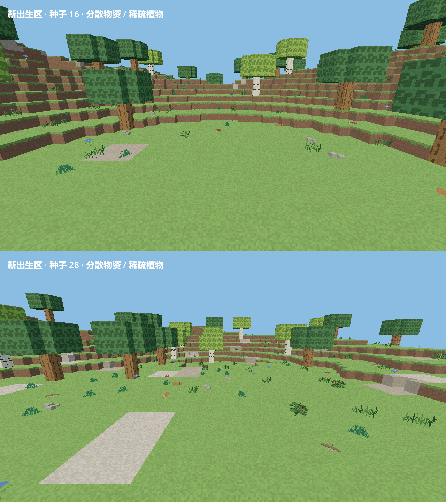

# 自然地表与永久删除更新

新版：`builds/EmberLighthouse-natural/EmberLighthouse.exe`。完整解压 `EmberLighthouse-natural试玩包.zip` 后运行。

## 出生区重复物体

截图中黄色圆柱是可徒手采集的地面原木，灰色方块是碎石。旧生成器为了保证起步材料，在每个种子的相同坐标放置两排原木、碎石和三株浆果灌木，因此每次出生都会看到相同排列。

生成器 5 取消这组固定排列。起始物资按种子分散在出生点周围 6–20 格范围，避开水面与树干，保留起步材料数量；同一种子可复现位置。碎石改为三块较小石头的组合，去掉砖块纹理，保持徒手采集和无阻挡碰撞。

## 植被疏密

自然草花、灌木和蘑菇改用稀疏斑块分布，不再在大量地表格子连续出现。根据森林、草甸、旱地、寒地、岩地和湿地设置不同密度，保留空地和植物间距；陡坡减少小型植物，芦苇仍限于岸边。树木和八种新植物保留。

六类区域的固定采样检查均确认小型植物数量减少至少约三分之二，且覆盖率低于 10%。这些数值描述游戏采样结果，不代表真实生态模拟。

## 已有探索版世界

地形版本 4 的世界，在主菜单的世界管理中新增「更新自然地表」。确认后使用稀疏植被和分散物资，山体、湖泊、矿层和洞穴保持一致；保留玩家编辑、建筑、容器物品、作物状态、装备和主线进度。默认在更新前创建一份原存档备份，也可取消该选项。

新建世界直接使用版本 5。版本 1、2、3 的旧世界保留原生成方式；版本 4 也只有在主动更新后才改变自然地表。

## 永久删除

上版删除只是把目录移到 `deleted-worlds`，并未清除文件；上版备份列表只有恢复入口。

- 世界管理 → 删除 → **永久删除世界**：清除该世界的保存代际、区块文件和同编号的已删除副本。默认勾选一并清除该世界的备份，可取消。
- 世界管理 → 已删除世界 → 对应条目的 **永久删除**：清除选中的已删除副本，可一并清除对应备份。
- 世界管理 → 从备份恢复 → 对应条目的 **永久删除备份**：只删除选中的备份，活动世界保留。损坏的备份也能清理。

永久删除直接清除存档目录，不进入可恢复列表或系统回收站。界面显示明确说明和确认按钮；取消不处理文件。普通「确认删除」仍然移到可恢复列表。

删除按世界编号和备份键限定范围，同名的其他世界和备份不会被清理。检查路径边界、链接目录、只读文件和占用情况，失败时不会报告删除成功。

## 验证

本包通过 73 项核心检查及 9 组冻结发布版检查，包含启动、自然地表与永久删除、探索日志、主线、战斗、生物、装备、图标界面和存档界面。

核心检查覆盖 100 个种子的物资位置、起步材料可获得性、六类环境植被密度及物种保持、小石块网格、更新地表后建筑及容器保存、活动世界与已删除副本的永久删除、备份保留选项、损坏备份和文件占用。

原生游戏检查覆盖删除取消、永久删除按钮、备份永久删除、已删除副本永久删除和旧地表更新。删除测试仅使用工作区中新建的临时存档。截图由游戏渲染器生成。
