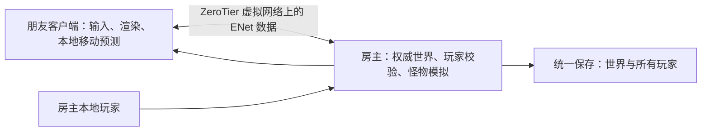

# 方野：余烬灯塔——虚拟局域网联机方案

编制日期：2026-10-12。状态：方案对应的联机试玩版本已实现；本机多进程与发布包验证见测试记录，实际异地真人试玩仍需确认。使用步骤见 [联机试玩说明](联机试玩说明-2026-10-12.md)。以下清单保留为原设计与验收依据，不将所有长期测试目标视为已完成。

采用“ZeroTier 组网 + Godot ENet + 玩家开房”。房主电脑运行世界与怪物模拟、保存存档，朋友通过房主的虚拟 IPv4 地址加入。ZeroTier 负责异地网络连通，游戏负责多人状态同步，两部分分别验证。

## 1. 第一版范围与玩法规则

- 支持 Windows x64、总人数 2–4 人，包含房主；所有人使用同一个游戏构建。
- 保留单人模式；新建世界和已有世界都能开启联机，已有世界在首次转换前自动备份。
- 玩家分别拥有背包、快捷栏、装备、生命、饥饿、经验、效果、复活点和地图探索记录；默认各自探索地图。
- 共享方块、箱子、熔炉、作物、掉落物、昼夜、天气、灯塔和主线进度；游戏模式与难度由房主设定。
- 默认合作模式，关闭玩家互伤。普通死亡只处理该玩家；Boss 战在所有参战玩家死亡或离开后重置战斗，不因一人死亡重置。
- 箱子和熔炉第一版采用单人操作锁：有人打开时，其他人看到占用提示；关闭或断线释放锁。
- 睡觉跳过夜晚需要全部在线且存活的玩家满足睡眠条件；有人退出床则取消。
- 打开背包、地图、日志、暂停菜单，以及窗口失焦，只停止本人的操作，联机世界继续运行；单人暂停规则保留。
- 玩家断线后可以重新加入并恢复身份；房主正常退出时先保存，通知客户端返回菜单。
- 房主崩溃或被强制关闭时，客户端停止操作，房主重启后从最近完整存档恢复。自动保存间隔先沿用 60 秒。
- 首版不包含主机迁移、24 小时独立服务器、Steam/Epic 登录、自动公网发现或一键组网。游戏内直接填写地址，不依赖广播发现。

## 2. 网络与玩家操作

### 先验证异地网络

1. 房主与朋友安装 [ZeroTier One](https://www.zerotier.com/download/)。
2. 房主在 [ZeroTier Central](https://central.zerotier.com/) 创建一个私有网络，记录 Network ID。
3. 每个人在 ZeroTier 客户端选择 Join Network，填写同一个 Network ID。
4. 房主在控制台核对设备的 ZeroTier 地址并授权，确认每台设备均显示连接正常，获得 Managed IP。
5. 使用与家里现有 LAN、其他 VPN 不冲突的虚拟 IPv4 网段；记录房主的 Managed IP。Network ID 与玩家连接地址不同，游戏里填写的是 Managed IP。
6. 房主与朋友互相测试，例如房主虚拟 IP 为 `10.147.17.2`，朋友运行 `ping 10.147.17.2 -n 30`，并在晚间常用时段再测一次。
7. 查看 `zerotier-cli peers` 中目标设备的路径，确认是否直连；若命令未在 PATH 中，使用安装目录里的 CLI。初始少量数据可能走中继，持续通信后再检查。
8. Ping 不通时先检查授权、地址与路由冲突、ICMP 防火墙规则；Ping 成功后仍需通过游戏 UDP 握手验证，不能据 Ping 单独判定游戏可连接。

组网流程依据 [ZeroTier 官方教程](https://docs.zerotier.com/start/)；界面随新旧 Central 版本不同而变化。当前个人非商业免费套餐为一个网络、10 台设备，足以覆盖本方案的朋友联机；套餐限制以 [官方价格页](https://www.zerotier.com/pricing/) 为准。教程中的旧套餐额度不作为本方案依据。

### 联机版本完成后的操作

房主：进入自己的世界 → 暂停菜单 → “开放联机” → 选择人数上限、端口 → 开始。显示房主虚拟地址、端口、在线人数与复制地址按钮。

朋友：主菜单 → “加入联机” → 填写昵称与 `10.147.17.2:24567` → 加入。依次显示连接、版本检查、同步世界、加载出生区域、进入游戏。

默认游戏端口选为 **UDP 24567**，允许修改；它是本项目约定，不是 ZeroTier 固定端口。开发时 ENet 的最大远程客户端数设为 3，总人数为 4，房主同时作为玩家。

房主防火墙只需允许游戏使用该 UDP 端口接收已授权虚拟网络成员的连接。规则覆盖 ZeroTier 网卡实际采用的网络配置文件，并限制到虚拟网络地址范围；不要求关闭防火墙。可以将 ENet 绑定到选定的虚拟网卡地址。使用同一 Wi-Fi 时也可绑定 LAN 地址并直接连接。

无需把游戏端口映射到公网路由器。若 NAT 或运营商网络阻止 ZeroTier 直连，组网工具可能使用中继，性能必须实测：[官方中继说明](https://docs.zerotier.com/faq/relaying/)。

## 3. 游戏内部结构

### 改造位置

| 现有模块 | 现状 | 计划修改 |
| --- | --- | --- |
| `src/Game.cs`、`src/GameUi.cs` | 单个 `Explorer`，界面状态决定世界是否运行 | 增加单人／房主／客户端角色，分离世界模拟、本地输入与界面；增加开房、加入、断线界面 |
| `src/World/WorldState.cs` | `WorldSnapshot` 同时包含世界与单个玩家数据，当前格式 7 | 提取 `PlayerState`；世界存档保存玩家集合，按玩家上下文调用背包、生存、制作、死亡逻辑 |
| `src/Player/Explorer.cs` | 直接读取本地输入并写入单个玩家位置 | 分离本地操作、网络输入与远端角色表现；仅本地摄像机处于 Current 状态 |
| `src/Creatures/*`、`src/MainlineGame.cs` | 怪物和 Boss 依赖单个玩家 | 房主选择有效玩家目标、执行伤害；客户端接收实体与战斗状态；调整团队死亡规则 |
| `src/Rendering/ChunkRenderer.cs` | 地形渲染与碰撞围绕本地玩家加载 | 本地只渲染自己的可见区域；房主额外维护所有玩家及活跃生物所需的模拟碰撞区域 |
| `src/Persistence/*` | 保存一套世界与玩家状态 | 所有玩家加入同一代际保存；客户端不写房主世界；增加旧格式迁移与兼容验证 |

建议新增 `src/Networking/NetworkSession.cs`、`Protocol.cs`、`WorldSync.cs`、`PlayerRegistry.cs`、`GameCommands.cs`，将连接生命周期、报文校验、区块同步、玩家身份、动作提交分别集中管理。界面入口可放在 `src/MultiplayerUi.cs`；测试继续使用现有独立 .NET 测试程序与 Godot 多进程验证。

### 权威状态与同步

- 房主唯一决定物品增减、方块变化、容器事务、怪物 AI、伤害、死亡、任务、时间和天气。房主自己的动作也走同一处理入口。
- 客户端发送“挖掘／放置／攻击／合成／转移物品”请求；房主校验玩家身份、距离、冷却、材料和对象当前版本，成功后发送结果与增量。
- 请求带序号，房主去重；重要事务带对象版本，过期请求拒绝并重新同步。两人同时拾取同一个掉落物时，只提交一次。
- 首版移动采用本地预测：客户端立即移动，发送带序号的输入，房主计算或校验并纠正；远端角色插值显示。对本地移动做纠正时必须重放未确认输入，避免跳跃被反复拉回。
- 开始时以移动输入约 30 次／秒、状态快照约 15–20 次／秒为调优起点；重要变更立即发送。以上是实现参数，不是已测性能结论。
- 世界变化与背包事务使用可靠传输；移动快照使用有序的不可靠传输，含序号与时间。区块初始化放在独立可靠通道，避免大块数据堵塞动作消息。依据 [Godot ENet 与 RPC 文档](https://docs.godotengine.org/en/4.6/tutorials/networking/high_level_multiplayer.html)。
- 握手核对协议版本、游戏构建、物品／配方／生物数据摘要、世界种子、生成器版本与玩法规则；不一致时在进入世界前给出原因。
- 地形可用相同种子及生成器重建；同步玩家附近区块的改动、设施、实体与进度，不传输整张原始地形或每帧整个存档。
- 区块基线带版本号；初次同步期间排队后续增量，基线确认后按版本应用。缺失或冲突时重发该区块，确保中途加入也能看到正确建筑。
- 区块数据、报文长度、队列、发送频率设上限；网络线程不直接修改 Godot 场景或可变世界字典。
- 离开兴趣范围的区块可卸载；重新进入时比较版本并补齐变化。跨区块的 Boss 或投射物按实际范围同步。
- 房主模拟碰撞不能只依赖房主摄像机：朋友走远时，区域仍需保持可活动，避免穿地、怪物停摆与失效拾取。

### 玩家身份与存档

- 使用持久玩家 ID，不能用昵称、IP 或 ENet 临时 Peer ID 作为存档键。
- 客户端保存本机身份凭据；房主绑定已接纳玩家并发放重连凭据，后续重连校验。身份文件被删除后按新玩家处理，旧角色可由房主显式重新绑定。
- 首次转换旧档前自动备份，保留已有世界 ID 与生成器版本；旧单人角色的背包、装备、生命、位置等归房主，不给每个访客复制。
- 新访客在安全出生点获得新角色；原有死亡背包归房主，新死亡背包记录所属玩家。首版仅允许所属玩家拾取死亡背包，普通主动丢弃物品可共享。
- 建议实施时将存档格式从 7 升到下一版，正式编号先核对当前代码；迁移、回退提示与统一代际提交一起修改。
- 断线时先结算已确认事务、归还制作格／鼠标物品、解除容器锁与坐骑占用，再保存角色。重连不能重放已完成物品事务。
- 房主停止开放联机时通知并移除客户端、保存全部玩家，再返回单人模式；房主退出后不把世界迁移到朋友电脑。

## 4. 实施清单与交付关卡

- [ ] **验证网络路径**：双方安装并授权 ZeroTier，记录晚间 Ping、丢包和目标设备是否中继，确认异地 UDP 连通。
- [ ] **提取玩家状态**：将 `WorldSnapshot` 的玩家字段提取为 `PlayerState`，让 `Explorer`、背包／生存／死亡逻辑显式使用所属玩家；验证原单人操作不变。
- [ ] **迁移存档**：增加持久玩家身份、玩家集合及死亡背包归属，接入现有保存／恢复流程；验证真实旧档、备份恢复与崩溃恢复。
- [ ] **实现连接与入口**：增加 ENet 房主／客户端角色、最多 3 个访客、版本握手、地址输入、加载进度和断线返回；先以两进程验证。
- [ ] **同步移动与地形**：实现输入、纠正、远端人物、出生区加载、区块基线和增量；实现多玩家区域的房主碰撞加载。
- [ ] **提交物品与建造事务**：统一挖掘、放置、制作、拾取、箱子、熔炉、耕种、开门等动作；加入容器锁、版本校验和重复请求去重。
- [ ] **扩展生存与战斗**：同步怪物、投射物、伤害、坐骑／驯养归属、各玩家死亡、睡眠与共享主线；修正联机暂停与失焦行为。
- [ ] **执行多人回归**：运行单人、旧档、双人争抢、四人分散探索、中途加入、重连、房主退出与强制终止测试；增加重复／过期／畸形报文验证。
- [ ] **交付异地试玩包**：导出与校验 Windows 包，附加入说明；至少两台异地电脑试玩并记录实际性能，再决定是否扩大人数。

连接原型、移动建造原型和完整合作试玩版分开交付。只看到两个人物不代表联机完成；物品、怪物、存档与断线关卡都通过后才标记为可合作生存版本。网络验证后再估算开发时长，不承诺未经原型支持的交付日期。

## 5. 验收与性能目标

网络目标先定为常用时段往返延迟平均不高于 100 ms、明显抖动较少、短测无丢包；不满足时继续诊断，不能据此保证或否定游戏可玩。游戏还需记录动作确认时间、房主帧耗时、每客户端带宽、区块同步大小和重连恢复时间。

必测场景：

1. 同一台电脑两个进程以 `127.0.0.1:24567` 联机，证明游戏协议工作；这不能代替异地测试。
2. 四人同时在线且分头走出房主视距，地形碰撞、怪物、拾取仍正常。
3. 两人同时挖同一格、拿同一物品、打开同一箱子，不增加物品总数，不产生不同方块结果。
4. 玩家加入前已有建筑，加入同步期间房主继续修改建筑，双方最终区块摘要一致。
5. 朋友掉线再进，恢复其背包、装备、位置和经验；不能获得房主角色或重复死亡掉落。
6. 房主开地图／背包或切换窗口，其他人仍能移动、战斗，世界计时继续。
7. 一个玩家死亡不重置其他玩家或整场 Boss；全部参战玩家失败时按团队规则重置。
8. 正常保存退出后重开，恢复所有已保存玩家及共享世界；保存失败明确提示，不误报完成。
9. 房主被强制关闭，客户端不能继续产生有效物品或世界变化；房主恢复最后完整代际。
10. 不同构建、满员、错误地址、UDP 被拦截、初始化中断都有可理解提示。

上述功能测试在 LAN、ZeroTier 异地直连条件下执行；若实际网络走中继，也单独记录表现。在可控测试环境下加入延迟／丢包再验证纠正、重发和事务去重。第一轮网络测试可在游戏开发前完成。

## 6. 排障顺序

- 加入不了虚拟网络：检查授权与 ZeroTier 在线状态。
- 虚拟 IP 不通：检查路由冲突、网卡地址与 ICMP 规则。
- Ping 通但游戏连不上：检查房主是否开放联机、端口、ENet 绑定地址、游戏 UDP 防火墙规则和构建一致性。
- 只有中继且延迟高：确认 UDP 出站未被阻止，换有线网络／移动热点对照测试；参考 ZeroTier 官方中继说明。不能保证任何网络都能打洞直连。
- Ping 稳定但游戏卡：检查房主帧耗时、上传带宽、区块同步拥塞与消息处理，不把所有卡顿归于组网工具。

## 7. 费用与当前状态

朋友间个人非商业组网可先使用 ZeroTier 免费套餐，不租游戏服务器，房主承担自己电脑的运行与网络费用。正式商业分发若需要捆绑组网服务，应另行核对服务许可与套餐；本方案是个人朋友试玩。

当前已实现联机代码与三款获批角色，使用方法见联机试玩说明。未安装 ZeroTier、创建网络或更改你电脑的防火墙；这些操作由实际开房的玩家完成。

### 当前实现与原设计的差异

移动采用客户端即时操作、房主位置和碰撞检查及远端插值，约 20 次／秒；世界与个人状态约 5 次／秒，重要动作处理后立即推送。首个同步包包含压缩的世界稀疏修改与状态，后续发送方块增量；原设计中的完整输入重放、按附近区块分批首次加载与大型世界带宽优化仍属于后续工作。本版不提供主机迁移或独立服务器。
